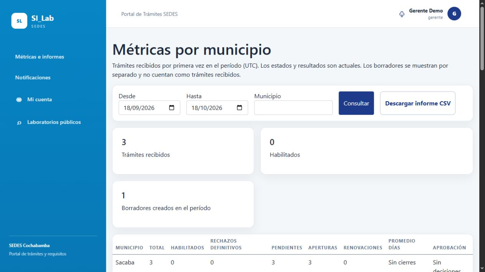

# Resultado de las correcciones de SI Lab

18 de octubre de 2026. Se implementó el plan aprobado por el usuario. La solución compila sin errores/advertencias y las 42 pruebas ejecutadas aprobaron. La base local se respaldó y migró conservando sus registros. No se realizó commit, push ni despliegue.

Los defectos de implementación identificados se corrigieron y se agregaron las funciones faltantes. Para completar la aceptación institucional todavía deben cargarse los formularios, catálogos y fuentes oficiales; los registros demo no se declararon válidos por suposición.

## Resultado por hallazgo

- F01: observaciones documentales/legales no pueden pasar directamente a inspección. Se conserva un retorno propio para incumplimientos de campo con documentación revisada.
- F02: la aprobación legal exige datos oficiales válidos, documentos conformes y una inspección conforme validada. El texto de error del lector de pantalla no puede convertirse en un laboratorio.
- F03: citación identificable con emisión, motivo, evidencia PDF/JPG/PNG, vencimiento y anticipación; avisos próximo/vencido a propietario y supervisor sin duplicados. Se comprueba que el expediente no esté cerrado.
- F04: revisión por documento y versión, observaciones subsanables, devolución al propietario y rechazo definitivo separados.
- F05: requisitos congelados al recibir el trámite, vigencia de cada resolución y PDF de cierre inmutable. Una renovación no modifica el informe anterior.
- F06: reemplazos conservan registro, archivo y decisión anteriores. Los complementos observados pueden retirarse de la presentación actual sin borrar su historial.
- F07: la comprobación de agenda excluye la propia reserva sustituida y sigue bloqueando otras visitas solapadas.
- F08: un catálogo sin obligatorios admite revisión coherente sin pedir un archivo artificial.
- F09: el coordinador asigna y el supervisor organiza inicio/fin; el horario es opcional en la asignación. Reprogramaciones y avisos conservan historial.
- F10: lista de verificación y plantilla por inspección; preparación del contenido, descarga de formulario/resumen y carga firmada. Los artículos y la plantilla institucional real siguen pendientes de carga.
- F11: requisitos y sus plantillas disponibles públicamente desde la landing, separados de documentos privados.
- F12: métricas con borradores aparte, apertura/renovación, tiempos, tasa, rendimiento y trazabilidad; CSV del mismo conjunto filtrado y definiciones visibles.
- F13: un PDF cargado inicialmente puede asociarse a un requisito sin volver a enviarlo.
- F14: catálogos administrativos de tipo/municipio, dirección/contacto/código, mapa de ficha y acceso del propietario a sus expedientes/documentos. Los valores oficiales y datos reales siguen pendientes de fuente institucional.
- F15: enlace de ruta con origen elegido en Maps, disponible aunque se deniegue geolocalización.
- Adicional: las cargas con longitud HTTP excesiva se rechazan con 413 antes de interpretar formularios. Se corrigió el error interno detectado al probar el servidor real.

## Reglas aplicadas tras aprobar el plan

El acta no puede registrarse antes del inicio de la visita. El abogado dispone de rechazo definitivo; las devoluciones legales vuelven a revisión documental y después a legal sin repetir una visita conforme, salvo que marque expresamente la necesidad de inspección.

Las alertas de licencia conservan 30 días por defecto y las de subsanación 5; son configurables. Cada citación fija su anticipación. Los plazos hábiles excluyen fines de semana y feriados que cargue la institución; no se inventó un calendario.

La renovación sigue sumando un año desde la vigencia todavía activa o desde la aprobación si estaba vencida. La ventana anticipada se puede configurar, pero por defecto conserva el contrato previo.

Los establecimientos sin datos verificados se excluyen de producción y no renuevan automáticamente. En desarrollo se identifican como demo/pendientes. La pantalla de validación enumera inconsistencias sin otorgar habilitaciones administrativas ni inventar propietarios o fechas.

## Comprobaciones realizadas

- Compilación Release estricta: 0 errores y 0 advertencias.
- Suite completa: 42 aprobadas, 0 fallidas, 0 omitidas.
- Migraciones con datos de versiones anteriores y esquema EF sincronizado.
- Concurrencia: misma decisión una sola vez y horarios simultáneos sin doble reserva.
- Kestrel real: 413 en carga individual de longitud declarada superior a 11 MB y registro inicial superior a 55 MB.
- Navegación en copia temporal: directorio/requisitos, acceso, revisión de PDF, programación de visita y métricas.
- Detalle y métricas en escritorio y móvil de 390 × 844 sin desbordamiento horizontal del documento.

La evidencia detallada está en [VERIFICACION.md](../VERIFICACION.md), y la correspondencia de los 36 casos de uso en [CASOS_DE_USO.md](CASOS_DE_USO.md). El total de pruebas incluye casos parametrizados y no equivale a una prueba independiente para cada requisito institucional.

La captura usa ejemplos creados únicamente en la copia temporal; no representa expedientes o indicadores reales del SEDES.

## Conservación de los datos locales

Respaldo previo: `App_Data/backups/20261018-184359/si_lab.db`, ignorado por Git. Los documentos originales referenciados eran cero, por lo que no había archivos de expedientes locales que copiar. Una instalación con documentos debe respaldar conjuntamente su almacenamiento.

Se aplicaron `AuditCorrections` y `InspectionFormSnapshot`. La base tiene ahora seis migraciones, integridad `ok` y ninguna referencia rota. La comparación contra el respaldo confirmó que se conservaron todos los campos anteriores de las tablas de negocio.

Siguen existiendo seis usuarios, tres requisitos, tres laboratorios y un borrador. Los ejemplos de revisión y archivos sintéticos no se insertaron en esa base. Los tres laboratorios locales siguen pendientes de validación institucional; no se les asignó propietario ni vigencia.

Para expedientes heredados con datos históricos incompletos, las referencias reconstruidas están identificadas. Una aprobación global anterior no se presenta como decisión individual con revisor o fecha inventados. Un cierre sin vigencia histórica registrada no copia la vigencia actual como sustituto.

## Lo que falta aportar desde el SEDES

1. Nombres y caracterización oficiales de los tipos de laboratorio, municipios y requisitos definitivos.
2. Formularios institucionales de acta/citación y lista de comprobación con sus artículos.
3. Fuentes para validar establecimientos, propietarios, ubicaciones, licencias y vigencias reales.
4. Feriados y confirmación de las anticipaciones, destinatarios y ventana de renovación configurables.

El administrador ya tiene pantallas para configurar catálogos y formularios. Los datos reales deben contrastarse con sus fuentes antes de utilizarlos; este trabajo no certifica autenticidad de firmas, habilitaciones ni contenido normativo. Producción exige configuración para nuevos trámites y actas reales.

## Entrega

Código, migraciones, pruebas y documentación quedaron en el espacio de trabajo. Se conservaron los cambios locales que existían antes de esta intervención. No hay publicación remota ni despliegue. El plan técnico está implementado y verificado; la aceptación institucional permanece condicionada a los insumos anteriores.
